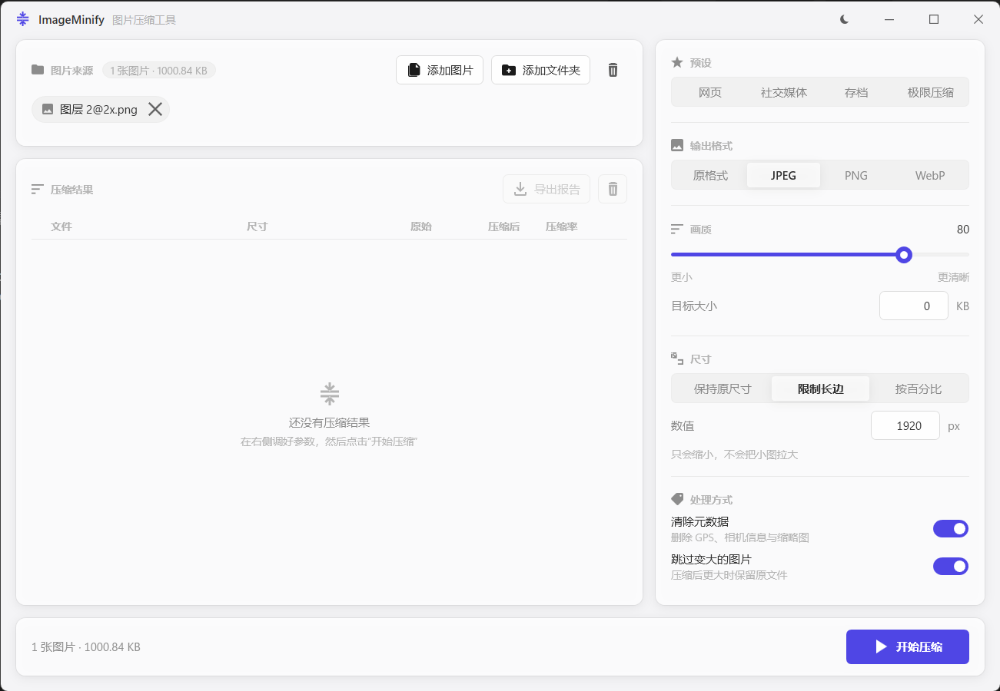

# 图片压缩工具 (ImageMinify)


[English](README_EN.md) | 中文

一个 Windows 桌面图片压缩工具，基于 C# WPF 开发。JPEG / PNG / WebP 三条独立压缩链路，支持目标体积反查、批量并行、缩放、元数据清理与前后对比预览。

## 相关项目

本项目有两个版本，满足不同使用场景：

| 版本 | 描述 | 开源地址 |
|------|------|----------|
| **桌面版** | 当前项目，基于 C# WPF 的桌面应用 | [ImageMinify](https://github.com/Moresyl/ImageMinify) |
| **网页版** | 基于 React + FastAPI 的在线图片压缩工具 | [snapimg](https://github.com/Moresyl/snapimg) |

## 功能特点

- **多格式支持**：输入 JPEG / PNG / BMP / WebP，输出 JPEG / PNG / WebP 或保持原格式
- **目标体积**：填入目标 KB，引擎二分查找能落在该体积以内的最高质量，无需手动试参数
- **预设**：网页 / 社交媒体 / 存档 / 极限压缩四组预设，参数在界面上写明，改动任一项预设高亮即取消
- **批量并行**：按 CPU 核心数并行编码，可取消，取消后已完成的结果照常保留
- **尺寸缩放**：按长边像素或百分比缩放，小于目标尺寸的图片不会被放大
- **四种输出去向**：加后缀 / 写入 `compressed` 子目录 / 指定输出目录（保持子目录结构）/ 覆盖原文件
- **变大即跳过**：重新编码已优化过的图片通常会变大，此时默认保留原文件
- **元数据控制**：可精简设备 / 时间 / 软件信息，或清除 EXIF、IPTC、XMP；保留显示所需的 ICC 色彩配置，避免清理隐私信息导致偏色
- **前后对比**：结果行可打开擦除式对比预览，按住拖动即可在同一块位置上逐像素比较；可滚轮缩放到 1:1 乃至 8 倍，放大时按最近邻绘制，压缩产生的振铃与色块一眼可见，透明区域衬棋盘格
- **CSV 报告**：导出每个文件的原始 / 压缩体积、压缩率、尺寸、质量、耗时与错误
- **原生加速**：检测到 imagequant / MozJPEG / oxipng 时自动启用，未安装则回退到 ImageSharp
- **完整中英双语**：设置中心内切换语言，主界面、设置、更新、弹窗与错误信息即时同步，不重启、不打断正在进行的压缩
- **深浅色主题**：跟随选择持久化，界面为自绘控件模板，字号与间距统一
- **设置中心**：统一管理界面语言、深浅主题、自动检查更新以及支持与诊断入口
- **一键更新**：显示当前版本、检查 GitHub Release、阅读双语更新说明并在应用内下载与重启安装
- **可复制错误诊断**：错误弹窗可直接复制脱敏后的版本、系统、架构、运行时与异常详情，方便提交问题
- **设置持久化**：压缩参数、界面语言、主题、自动更新与上次的文件列表自动保存

## 技术栈

- **框架**：.NET 10 + WPF（纯原生控件模板，无第三方 UI 库）
- **图像处理**：[SixLabors.ImageSharp](https://github.com/SixLabors/ImageSharp)
- **EXIF 读取**：[MetadataExtractor](https://github.com/drewnoakes/metadata-extractor-dotnet)
- **MVVM**：[CommunityToolkit.Mvvm](https://github.com/CommunityToolkit/dotnet)
- **原生压缩**：imagequant、MozJPEG、oxipng（均为可选）

## 截图



## 最新版本

**v3.0.0** — 界面重构与压缩引擎重写

从 [Releases](https://github.com/Moresyl/ImageMinify/releases) 下载最新版本。

## 安装方法

### 方法 1：下载可执行文件

1. 从 [Releases](https://github.com/Moresyl/ImageMinify/releases) 页面下载最新版本
2. 解压缩下载的文件
3. 双击 `ImageMinify.exe` 运行程序

### 方法 2：从源代码构建

**前置要求**：
- [.NET 10 SDK](https://dotnet.microsoft.com/download/dotnet/10.0)

```bash
# 克隆仓库
git clone https://github.com/Moresyl/ImageMinify
cd ImageMinify

# 构建项目
dotnet build -c Release

# 运行程序
dotnet run -c Release
```

## 使用方法

1. **添加图片**：
   - 直接把图片或文件夹拖进窗口
   - 或点击「添加文件」「添加文件夹」按钮
   - 文件夹可选择是否递归处理子目录

2. **选一个预设，或自己调**：
   - 预设：网页、社交媒体、存档、极限压缩
   - 手动：输出格式、质量、缩放、元数据处理
   - 或填写目标体积（KB），由引擎反查质量

3. **确认输出去向**：
   - 加后缀（默认，`_compressed`）
   - `compressed` 子目录
   - 指定输出目录
   - 覆盖原文件（不可撤销，开始前会二次确认）

4. **开始压缩**：
   - 点击「开始压缩」，进度与已完成结果实时显示，随时可取消
   - 结果行可打开文件、定位到文件夹、或打开前后对比预览
   - 需要留档时导出 CSV 报告

## 发布构建

```bash
# 发布为独立可执行文件
dotnet publish -c Release -r win-x64 --self-contained true
```

生成的文件位于 `bin/Release/net10.0-windows/win-x64/publish/` 目录。

## 项目结构

```
ImageMinify/
├── App.xaml(.cs)                 # 应用入口
├── GlobalUsings.cs               # 全局 using 声明
├── ImageMinify.csproj            # 项目文件
├── Models/                       # 数据模型
│   ├── AppSettingsSnapshot.cs    # 持久化设置快照
│   ├── CompressionOptions.cs     # 单次运行的全部参数
│   ├── CompressionPreset.cs      # 内置预设
│   ├── CompressionProgress.cs    # 进度回报
│   ├── CompressionResult.cs      # 单张图片结果
│   ├── CompressionSummary.cs     # 批量统计
│   ├── EngineCapabilities.cs     # 引擎能力
│   ├── SourceItem.cs             # 待处理的文件 / 文件夹
│   └── StatusSeverity.cs         # 状态级别
├── Services/                     # 业务服务
│   ├── ImageCompressor.cs        # 压缩主服务（编排）
│   ├── IFormatEncoder.cs         # 格式编码器接口
│   ├── JpegCompressor.cs         # JPEG 编码 + MozJPEG
│   ├── PngCompressor.cs          # PNG 量化 + oxipng
│   ├── WebpCompressor.cs         # WebP 编码
│   ├── BmpPassthroughEncoder.cs  # BMP 直通
│   ├── ExifService.cs            # EXIF 保留 / 精简 / 清除
│   ├── ThemeService.cs           # 深浅色主题
│   └── SettingsService.cs        # 设置持久化
├── ViewModels/                   # 视图模型 (MVVM)
│   └── MainViewModel.cs          # 主视图模型
├── Views/                        # 视图
│   └── MainWindow.xaml(.cs)      # 主窗口
├── Controls/                     # 自绘控件
│   ├── ComparisonSurface.cs      # 前后对比舞台（擦除、缩放、平移）
│   └── ComparisonGeometry.cs     # 对比舞台的几何计算（可单测）
├── Themes/                       # 调色板、控件模板、图标
├── Helpers/                      # 工具类
├── Interop/                      # 窗口边框等 Win32 调用
└── tests/                        # 单元测试
```

## 贡献

欢迎贡献！请查看 [贡献指南](CONTRIBUTING.md) 了解详情。

## 许可证

本项目采用 MIT 许可证 - 详见 [LICENSE](LICENSE) 文件。

## 致谢

- [SixLabors.ImageSharp](https://github.com/SixLabors/ImageSharp) - 跨平台图像处理
- [CommunityToolkit.Mvvm](https://github.com/CommunityToolkit/dotnet) - MVVM 工具包
- [MetadataExtractor](https://github.com/drewnoakes/metadata-extractor-dotnet) - 图片元数据读取
- [imagequant](https://github.com/ImageOptim/libimagequant) / [MozJPEG](https://github.com/mozilla/mozjpeg) / [oxipng](https://github.com/shssoichiro/oxipng) - 可选的原生压缩加速
